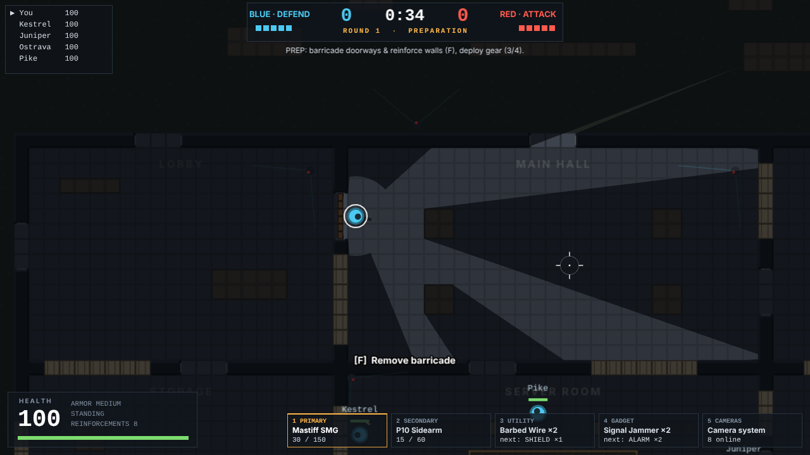

# Assailward 2D

A standalone **top-down tactical shooter** based on *Assailward*: 5v5 attackers versus defenders with faction loadouts, tactical utilities, side-specific gadgets, barricadable doorways, destructible and reinforced walls, drones and cameras, and a full objective mode — playable **offline against AI** in the browser.

Built with **Phaser 3.90**, **TypeScript 5.9** and **Vite 7**. All game rules live in a renderer-independent simulation (`src/sim/`) that is unit-tested and can play complete bot-vs-bot rounds headlessly.



## Quick start

Requirements: **Node.js 20.19+ or 22.12+** (required by Vite 7) and npm.

```bash
npm install
npm run dev
```

Open the URL Vite prints (default **http://localhost:5173**). Click **START MATCH**, pick a loadout, click **DEPLOY**.

Production build:

```bash
npm run build      # typecheck + bundle into dist/
npm run preview    # serves dist/ at http://localhost:4173
```

`dist/` must be served over HTTP (any static server works); opening `dist/index.html` directly from the file system is blocked by browsers for module scripts. No network access is needed at runtime: there are no external assets, fonts or services.

## How a match works

* **Teams:** you plus 4 AI teammates (BLUE) against 5 AI opponents (RED). Pick your starting side and AI difficulty (Easy / Normal / Hard) in the menu.
* **Match:** first to **4 round wins**. **Sides switch every 2 rounds.** Before each round you choose a loadout for the side you are on (and, as an attacker, a spawn).
* **Objective mode — Disruptor:** attackers must plant a disruptor inside the marked zone of the **Server Room** (hold **F** for 6 s) and keep it alive for **35 s**. Defenders disable it by holding **F** at the device for 8 s.

| Phase | Length | What happens |
| --- | --- | --- |
| Preparation | 40 s | Defenders barricade doorways, reinforce walls and place gear. Attackers are confined to their spawn zone and weapons-locked; they scout with **drones**. Nobody can be hurt. |
| Action | 2:50 | Free play. Attackers breach and plant. |
| Disruptor armed | 35 s fuse | Defenders must disable the device. |

| Attackers win if… | Defenders win if… |
| --- | --- |
| all defenders are eliminated | all attackers are eliminated before a plant |
| the planted disruptor detonates | the clock runs out without a plant |
| | the planted disruptor is disabled |

## Controls

| Key | Action |
| --- | --- |
| **W A S D** | Move |
| **Mouse** | Aim (your vision cone follows it) |
| **Left click** | Fire / use selected equipment |
| **Right click** | Precision aiming / secondary equipment action (roll grenade, detonate charges, next camera feed) |
| **F** (hold) | Contextual action: barricade or remove a barricade, reinforce a wall, plant / disable the disruptor, pick up your own gear, bash a barricade |
| **R** | Reload |
| **Shift** (hold) | Sprint |
| **Ctrl** or **C** | Crouch (toggle) |
| **Alt** | Quiet walk (toggle) |
| **1** / **2** | Primary / secondary weapon |
| **3** | Utilities — press again to cycle between your two utilities |
| **4** | Special gadgets — press again to cycle between your two gadgets |
| **5** | Camera system: drones (attackers) or the camera network (defenders). Press again to exit. |
| **Tab** (hold) | Scoreboard |
| **Esc** | Pause menu (resume, controls, fullscreen, volume, debug overlay, forfeit) |
| **V** | Melee strike *(additional key)* |
| **F3** | Debug overlay: doorway states, bot paths and AI state *(reveals AI information; for debugging)* |

Notes:

* **Ctrl and Alt are toggles**, not holds. Holding Ctrl while pressing W triggers the browser's close-tab shortcut and Alt+letter chords open browser menus, so the game toggles on a tap instead. A leave-page confirmation guards against accidental tab closes during a match, and fullscreen mode (pause menu) asks Chromium browsers to capture shortcut keys.
* In the camera system: WASD drives your drone, the mouse pans, left click **marks** a visible enemy for your team, right click switches feeds, and F deploys your second drone.
* When dead, left/right click cycles spectated teammates and 5 opens your team's cameras/drones.

## Key systems

### Doorways and barricades (no doors)

There are **no conventional doors** anywhere — no hinges, opening/closing, locks or handles (a unit test scans the source to keep it that way). Maps contain permanent **doorways**: open passages that allow movement, vision and gunfire.

* Defenders **hold F** at an eligible doorway to build a wooden barricade (2.6 s). Planks appear progressively with hammering sounds. Releasing F cancels construction.
* A completed barricade is real geometry: it blocks movement, vision and bullets. Anyone standing in the opening is pushed out to their side.
* Barricades are **localized**: the 48 px opening is split into six 8 px sections, each with its own HP. Bullets damage only the section they hit, melee damages sections in its arc, and explosions damage each section by distance. Destroyed sections are holes that let vision and bullets through.
* An operator can pass once a **contiguous gap of at least 22 px** (three sections) is open. The rest of the barricade stays, and **damage persists all round**.
* Defenders can remove their own barricade (hold F, 1.2 s). Tearing down a *damaged* barricade leaves that doorway permanently open for the round.
* Sounds play on construction, every hit, section breaks and destruction (bots hear them too).
* Drones slip **under** barricades.
* The AI queries each doorway's state: `open`, `building`, `barricaded`, `damaged` (holes but not passable), `breached` (passable), plus `obstructed` (e.g. a shield) and `breachable`. Navigation avoids barricades (defenders), plans to breach them (attackers), or ignores them (drones).

### Walls and breaching

* **Concrete** walls and props are indestructible.
* **Soft walls** (tan) have per-cell HP: bullets chip them, shotguns and explosives open them, and the soft-breach charge and Breaching Hammer blow them open.
* **Reinforced walls** (steel) are immune to everything except the **hard-breach charge**. The Server Room's south wall starts reinforced. Defenders can reinforce soft wall panels (up to 4 cells each) with **F** (3.5 s, 8 reinforcements per team).
* **Soft-breach charges** go on barricades or soft walls; **hard-breach charges** only on reinforced walls. Both detonate remotely with right click and can be stopped by a defender's Signal Jammer.

### Directional centerline damage

Firearm damage scales with how close the shot's **trajectory** passes to the target's **centre**, measured perpendicular to the direction of fire:

```
d          = |cross(D, C - P)|          D = unit shot direction, C = target centre, P = point on trajectory
proximity  = clamp(1 - d / R, 0, 1)     R = collision radius (9 px)
multiplier = 1 + 0.5 * proximity        1.00x at the edge .. 1.50x dead centre
```

The multiplier is only applied after the trajectory is confirmed to intersect the hitbox. It ignores target facing, works from every direction, never exceeds 1.5× and has no headshot multiplier on top. Damage numbers in-game show the multiplier, for example `41 ×1.43`. The full damage order (falloff → centerline → armour) is in [docs/DAMAGE.md](docs/DAMAGE.md).

### Equipment

Loadout = primary + secondary (faction restricted) + **two utilities** + **two special gadgets** + armour tier.

* **Global utilities:** Smoke Grenade, Flashbang, Frag Grenade
* **Attacker utilities:** Soft-Breach Charge, Hard-Breach Charge
* **Defender utilities:** Barbed Wire, Deployable Shield
* **Attacker gadgets:** Pulse Scanner, EMP Grenade, Breaching Hammer, Claymore
* **Defender gadgets:** Signal Jammer, Proximity Alarm, Bulletproof Camera, Impact Grenade
* **Baseline:** 2 drones per attacker, 6 map cameras for defenders

> **Provisional:** the original Assailward repository (`Aslkois/Assailward`) contains only a README and no gadget, weapon or map specifications. Every gadget, utility and weapon value here is therefore an original **provisional** design, labelled as such in the loadout screen. See [docs/GADGETS.md](docs/GADGETS.md).

### Information rules

* The overhead camera **never reveals enemies by itself**. You only see enemies inside your own line of sight: a vision cone (110°, 90° when precision aiming) plus a small close-awareness radius. Walls, intact barricade sections and smoke block it.
* The fog of war darkens everything outside your view. Enemy operators, gadgets, corpses, projectiles and effects are drawn only where you can see.
* Environment changes made by the enemy (new barricades, holes blown in walls) appear on your map only once you have seen them; your own team's changes are known immediately.
* Teammates call out what they see: last-known positions show as red diamonds for a few seconds. Camera/drone **marks** and the alarm track live briefly.
* **Bots use the same perception:** view cones with line of sight and smoke, hearing with wall occlusion (gunfire, footsteps, breaching, drones, alarms), and team call-outs. Nobody tracks enemy positions omnisciently.

### Map — Meridian Relay Station

An original 100×70-cell (1600×1120 px) facility with nine rooms around a central **Server Room** objective. It can be entered through north, east and south doorways, west and north soft walls, east soft walls, and a pre-reinforced south wall that needs a hard breach. There are three attacker spawns (North Gate, West Lot, Southeast Dock) and five scripted approach routes for the AI. Details: [docs/MAP.md](docs/MAP.md).

## Testing and validation

All of the following were run on the final code in this repository.

| Command | Result |
| --- | --- |
| `npm run typecheck` | Passes (game code and tests are typechecked separately; game code has no Node types). |
| `npm test` | **59 tests in 7 files pass**: centerline damage, barricades, walls/equipment/inventory, rounds/match, AI navigation and information rules, map validity, plus a headless bot-vs-bot match. |
| `npm run build` | Passes. One JS chunk of ~1.38 MB (~387 KB gzip), mostly Phaser. |
| `npm run smoke` | **20/20 real-input browser checks pass** in headless Chromium (needs the `playwright` package and a Chromium browser). |
| `npx vite-node scripts/diag.ts 24 normal` | Plays 24 bot-only rounds and prints outcome and behaviour statistics. |

The **unit tests** cover:

* Centerline scaling: centred, off-centre (25/50/75 %), edge, miss, behind the shooter, out of range, 64 firing directions, the 1.5× cap, and the damage pipeline order.
* Localized barricade sections, passability, hole sight lines, build/cancel/remove, and persistence.
* Breach charges, reinforcement, slot cycling with separate charges, firing and reload, drones and cameras.
* Prep-phase rules, plant/detonate/disable/timeout/elimination, and side switching.
* Doorway-aware navigation, smoke and wall line of sight, bot knowledge that comes only from perception, and the player's map knowledge.
* A scan proving the source contains no door mechanics.

The **browser smoke test** drives the real UI with mouse and keyboard and asserts on game state:
* Menu → loadout clicks → deploy.
* WASD movement, slot 3 cycling, right-click precision aim, the prep weapons lock, slot 5 drone feed open/close, Esc pause/resume.
* Firing and reload in the action phase, the sim running in real time, and a defender holding F to build a barricade.
* Round end → next round, sides switching after two rounds, the match ending at 4 wins, and Play Again.

**Bot-only gameplay validation** (24 rounds per difficulty, `scripts/diag.ts`):

| Difficulty | Attacker win rate | Outcomes | Avg round (incl. 40 s prep) |
| --- | --- | --- | --- |
| Easy | 0.38 | 9 defenders eliminated, 7 attackers eliminated, 7 disruptors disabled, 1 time-out | 96 s |
| Normal | 0.42 | 10 / 9 / 5 disabled | 81 s |
| Hard | 0.38 | 9 / 12 / 3 disabled | 78 s |

Across the 72 rounds the bots:
* scored about 186 kills per 24 rounds;
* built ~125 barricades and reinforced ~148 walls, and broke ~61 barricades open;
* flew 237 drones in prep and planted 27 disruptors;
* fired 35 hard-breach and 7 soft-breach charges;
* used flashes, frags, impacts, EMPs, pulse scans, the hammer, alarms, jammers, shields, wire and bulletproof cameras.

## Project structure

```
src/
  config/        data: constants, weapons, equipment pools, loadout rules
  sim/           renderer-independent game simulation (no Phaser imports)
    world.ts       entities, damage, events, sound, team intel, fixed-step update
    map.ts         grid, doorways, wall panels, rooms (parsed from ASCII map data)
    barricade.ts   localized barricade sections, passability, doorway state
    damage.ts      centerline multiplier + damage pipeline
    collision.ts, raycast.ts, sight.ts    geometry, ballistics, line of sight
    character.ts, combat.ts, equipment.ts, actions.ts   operator rules
    round.ts, match.ts, setup.ts          objective mode, match flow, round creation
    ai/            nav (A*), bot brain (perception/combat/tasks), team planner
    maps/          Meridian Relay Station layout + metadata
  game/          Phaser layer: scenes, renderers, input, HUD, procedural audio
tests/           Vitest suites
scripts/         smoke.mjs (browser test), diag.ts (bot statistics), genmap.py (map generator)
docs/            DESIGN, DAMAGE, GADGETS, MAP, screenshots
```

## Known limitations

* **Rendering performance was only measured in this container's headless Chromium with software WebGL (SwiftShader)**, where it renders at about 10–15 fps. The simulation still runs in real time because it uses the raw frame delta, and per-frame CPU work for rendering, AI and simulation is about 1 ms. It has not been profiled on a real GPU.
* **All gadget, utility and weapon numbers are provisional** originals, because the original project had no specifications to port.
* One map and one objective mode. Single floor only: no hatches, vertical play, windows, vaulting, rappelling or leaning.
* No downed-but-not-out state or revives. Bullets do not hurt teammates; explosives hurt yourself but not teammates.
* Bullets stop at intact barricade sections and soft wall cells (no wall-bang penetration); they open holes instead.
* AI limitations:
  * Tactics are scripted per role.
  * Attackers only pilot drones during preparation; afterwards, parked drones remain viewable.
  * Only one defender at a time "watches cameras".
  * Bots don't bank grenades off walls.
  * Bots occasionally get stuck briefly before their stuck-recovery repaths.
* Balance is defender-leaning (attacker win rate 0.38–0.42 in bot-only play). How it feels with a human player is untested beyond the automated checks.
* Audio is simple procedural synthesis: stereo pan and distance/wall attenuation, no HRTF.
* No mobile/touch controls and no online multiplayer.
